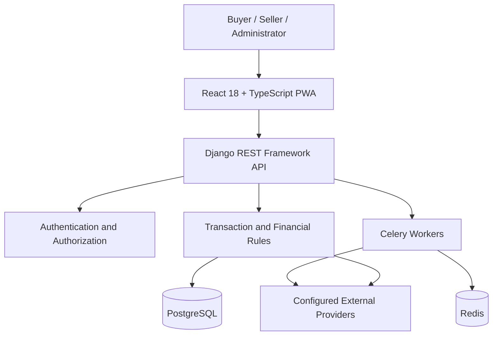

# Gasha Escrow
### Protecting Digital Marketplaces. Preventing Scams. Building Trust.

**Project Type:** Digital Escrow and Marketplace Security Platform  
**Target Market:** Ethiopia  
**Project Category:** Web Application, FinTech, E-Commerce Security  
**Frontend:** React 18, TypeScript, Progressive Web App (PWA)  
**Backend:** Python, Django, Django REST Framework  
**Repository Purpose:** INSA Graduation Project Documentation

---

## 1. Project Overview

Gasha Escrow is a digital escrow platform designed to improve trust, transparency, and transaction safety in online commerce in Ethiopia.

Online transactions frequently involve two parties who do not know each other personally. A buyer may pay for a product or service without receiving it, while a seller may deliver an item without receiving payment. These risks create uncertainty, discourage legitimate commerce, and make online transactions difficult to trust.

Gasha Escrow addresses this problem through an escrow-based transaction model. Instead of treating a buyer's payment and a seller's delivery as unrelated activities, the platform coordinates them within a defined transaction lifecycle.

The system is designed to record transaction agreements, track payment and delivery states, maintain transaction evidence, and provide a structured process for resolving disagreements.

The platform combines a web-based client with a backend API responsible for authentication, business rules, transaction processing, and financial state management.

Gasha Escrow is intended to support safer digital transactions while providing a foundation for future marketplace services, seller verification, payment integrations, and fraud-prevention capabilities.

## 2. Problem Statement

Digital commerce creates opportunities for individuals and businesses, but transactions between unfamiliar parties can expose both sides to fraud and operational risks.

Common challenges include:

- Buyers transferring money to fraudulent or unverified sellers.
- Sellers delivering goods or services without receiving the agreed payment.
- Disagreements about the condition, quality, or delivery of a product.
- Difficulty preserving and reviewing transaction evidence.
- Limited visibility into payment, delivery, and refund status.
- Weak accountability when a transaction does not proceed as agreed.
- Difficulty establishing trust between parties in online marketplaces.

Direct transfers and informal agreements do not necessarily provide a structured mechanism for coordinating payment, delivery, and dispute handling.

Gasha Escrow proposes a centralized transaction-management platform that helps establish clearer transaction conditions and records the progress of each transaction.

## 3. Proposed Solution

Gasha Escrow introduces a structured escrow workflow between buyers and sellers.

The central principle is that the transaction should progress according to defined conditions rather than relying entirely on trust between strangers.

The platform is designed to coordinate the following activities:

1. User registration and authentication.
2. Creation or acceptance of a transaction agreement.
3. Funding and payment-status tracking.
4. Seller delivery and submission of supporting evidence.
5. Review of delivery and transaction conditions.
6. Release, refund, cancellation, or dispute handling according to applicable rules.
7. Recording of transaction events for accountability.

The backend serves as the authoritative source for financial calculations and transaction-state transitions. The frontend presents transaction information and allows users to interact with the system through the API.

Actual fund custody, payment confirmation, and payout execution depend on the payment integrations and operational arrangements implemented for the deployed version.

## 4. Project Objectives

### 4.1 General Objective

To develop a secure, transparent, and reliable digital escrow platform that helps reduce fraud risks and improves trust between participants in Ethiopia's digital marketplace.

### 4.2 Specific Objectives

- Provide a structured transaction process for buyers and sellers.
- Reduce the risks associated with direct transactions between unfamiliar parties.
- Maintain clear records of transaction agreements and status changes.
- Support payment-status tracking and delivery verification.
- Provide a structured process for handling transaction disputes.
- Enforce server-side authorization and financial business rules.
- Maintain accurate financial values and transaction records.
- Improve the usability of online transactions through a responsive web application.
- Support English and Amharic user interfaces.
- Establish a technical foundation for future marketplace and payment integrations.
- Apply software engineering practices that support testing, maintainability, and security.

## 5. Intended Users and Stakeholders

### Buyers

Buyers use the platform to participate in transactions, review agreed conditions, monitor transaction progress, and provide delivery confirmation or supporting evidence where applicable.

### Sellers

Sellers use the platform to participate in agreements, monitor payment status, fulfill their obligations, and submit evidence of delivery or service completion.

### Administrators and Authorized Reviewers

Authorized personnel may be responsible for reviewing user verification, investigating disputed transactions, monitoring platform activity, and carrying out administrative actions permitted by the system's access-control rules.

Administrative privileges should be restricted according to defined roles and responsibilities.

### Payment and Service Providers

External providers may support payment initiation, payment confirmation, fund transfers, notifications, or other services. Their responsibilities depend on the integrations and agreements in place.

### Platform Operators

Platform operators are responsible for maintaining service availability, reviewing operational issues, protecting sensitive information, and ensuring that the platform follows applicable legal and security requirements.

## 6. How Gasha Escrow Works

The following describes the intended escrow transaction lifecycle. The precise steps and available actions depend on the implemented application version and its configured payment integrations.

### Step 1: Account Registration and Authentication

A user creates an account and authenticates through the available login process.

The backend validates authentication requests and applies the relevant account and access-control rules.

Account-related functionality may include identity verification and additional authentication controls where those capabilities have been implemented.

### Step 2: Agreement Between Buyer and Seller

The buyer and seller establish the terms of the transaction.

These terms may include:

- Product or service description.
- Agreed transaction amount.
- Seller obligations.
- Expected delivery conditions.
- Evidence requirements.
- Conditions for acceptance, cancellation, refund, or dispute resolution.

The agreement establishes the conditions against which the transaction will be evaluated.

### Step 3: Transaction Creation

The transaction is created and associated with the relevant participants and agreed terms.

The backend validates the request and determines whether the user is authorized to initiate or participate in the transaction.

The transaction receives a status representing its current position in the lifecycle.

### Step 4: Funding and Payment Verification

The buyer funds the transaction through a configured payment method, where supported.

The system must distinguish between a payment being initiated, a payment being confirmed, and funds being available for the transaction. These events are not necessarily equivalent.

Payment status should be established through the configured provider integration or an authorized verification procedure.

A screenshot or submitted receipt can provide supporting evidence, but should not automatically be treated as conclusive proof that funds have been received.

### Step 5: Seller Fulfillment

After the applicable funding conditions are satisfied, the seller proceeds with the agreed delivery or service.

The seller may submit evidence relevant to the transaction, such as delivery details or other supporting information.

The system records relevant updates and makes the transaction's progress visible to authorized participants.

### Step 6: Delivery Review and Acceptance

The buyer reviews the delivered product or completed service against the agreed terms.

Depending on the transaction workflow, the buyer may confirm acceptance, report a problem, or submit supporting evidence.

A defined inspection period can provide an opportunity to identify issues before the transaction is finalized, if that functionality is enabled.

### Step 7: Settlement

When the applicable release conditions are satisfied, the transaction may proceed to settlement.

Settlement should be controlled by backend business rules, not solely by frontend actions.

The system must validate the transaction's current state, verify the user's authority, and prevent invalid or duplicate financial operations.

The actual movement of money depends on the platform's custody model and supported payment arrangements.

### Step 8: Dispute Handling

If the buyer and seller disagree, the transaction may enter a dispute state according to the applicable rules.

A dispute workflow can preserve relevant evidence, record the parties' submissions, and pause settlement while the case is reviewed.

An authorized reviewer may determine the appropriate outcome under the platform's documented dispute policy.

The system should preserve a record of significant decisions and resulting state changes.

### Step 9: Transaction Completion

The transaction reaches an appropriate terminal state, such as completed, refunded, cancelled, or resolved following a dispute.

The transaction history should reflect the events and decisions that led to the outcome.

Not every transaction follows the same path. Cancellation, payment failure, delivery failure, and disputes may require different transitions and authorization rules.

MVP 
## 7. Transaction Lifecycle and State Management

Escrow transactions require controlled state transitions to prevent inconsistent financial outcomes.

An illustrative lifecycle is:

**Created → Awaiting Funding → Funded → Awaiting Delivery → Awaiting Acceptance → Completed**

Alternative paths may include:

- Funding failure.
- Cancellation before funding.
- Refund processing.
- Delivery failure.
- Dispute opened.
- Dispute resolved.
- Settlement failure requiring reconciliation.

The application should enforce permitted transitions on the backend. A user must not be able to bypass transaction requirements simply by modifying a frontend request.

Financial operations should be atomic where appropriate, idempotent where retries are possible, and traceable through transaction records.

The exact state names and permitted transitions must match the implemented application.

## 8. Core Functional Areas

### 8.1 Authentication and Account Management

The backend provides account-related API functionality and supports the configured authentication mechanisms.

The supplied project dependencies include libraries for JWT handling, one-time passwords, password hashing, environment configuration, and cryptographic operations.

These dependencies support security-related capabilities, but their presence alone does not establish that every corresponding feature is enabled.

### 8.2 Escrow Transaction Management

The transaction-management layer is responsible for coordinating the transaction lifecycle.

Its responsibilities include associating participants with transactions, validating business rules, managing transaction status, and enforcing permitted actions.

### 8.3 Financial Integrity

Financial operations require consistent representation and validation of monetary values.

The frontend specification establishes several important design rules:

- Financial calculations are authoritative on the server.
- Monetary values are represented using integer subunits until display.
- A shared formatting utility handles user-visible monetary values.
- Financial mutations carry an idempotency key.

These rules help reduce rounding inconsistencies, client-side manipulation, and duplicate operations caused by retries.

### 8.4 Payment Integration

The architecture supports integration with external services through appropriate backend interfaces.

Payment initiation, provider confirmation, reconciliation, and settlement should be treated as distinct operations.

The specific providers, supported payment methods, and operational fund-handling arrangements should be documented according to the deployed implementation.

### 8.5 Delivery Evidence and Verification

Transaction evidence helps participants and authorized reviewers assess whether the agreed conditions have been satisfied.

Evidence should be associated with the relevant transaction and protected through appropriate access controls.

The platform should distinguish between submitted evidence and independently verified facts.

### 8.6 Dispute Management

Dispute management provides a structured way to record disagreements and review transaction evidence.

Appropriate controls may include restricting settlement during an active dispute, recording decisions, and limiting dispute-resolution actions to authorized users.

### 8.7 Administration and Oversight

Administrative capabilities may support account review, transaction monitoring, dispute handling, and operational oversight.

Access to administrative actions should be restricted by role and recorded where appropriate.

### 8.8 Internationalization

The frontend documentation specifies English and Amharic translation catalogues.

Centralized translation management helps maintain consistent terminology across supported languages.

Automated catalogue checks help detect missing or inconsistent translations.

### 8.9 Progressive Web Application

The frontend is specified as an installable Progressive Web App.

The application shell can be precached to improve startup and offline access to static application resources.

The frontend specification explicitly excludes API responses from precaching. Financial operations and transaction status must not be represented as successful merely because a user is offline.

### 8.10 User Interface and Accessibility

The frontend follows the Gasha visual identity, with support for dark and light themes and Amharic typography.

The interface is designed to present transaction information, account-related pages, and application navigation through reusable components and route-based loading.

Reduced-motion preferences should be respected by animated interface elements where applicable.

## 9. System Architecture

Gasha Escrow follows a client-server architecture with a frontend application and a backend API.

### Frontend Layer

The frontend uses React 18 and TypeScript in strict mode.

Its responsibilities include:

- Rendering user interfaces.
- Collecting and validating user input.
- Managing application navigation and session presentation.
- Communicating with the backend API.
- Displaying transaction status and server-calculated financial information.
- Supporting language and theme preferences.
- Providing installable PWA functionality.

The frontend is not the authority for financial calculations or permission to execute escrow operations.

### Backend Layer

The backend uses Python, Django, and Django REST Framework.

Its responsibilities include:

- Processing API requests.
- Authenticating users and enforcing authorization.
- Applying business rules.
- Managing transaction state.
- Validating financial operations.
- Coordinating supported integrations.
- Persisting application data.
- Producing appropriate responses and error conditions.

### Database Layer

The supplied backend dependencies include a PostgreSQL driver.

The database is intended to persist application records such as accounts, transactions, and other domain data according to the implemented schema.

The database schema, constraints, transaction boundaries, and migration history should be verified against the actual codebase before being described as finalized.

### Background Processing

The supplied dependencies include Celery and Redis.

These technologies support asynchronous tasks and message-broker functionality. They may be used for tasks that should not block a normal API request, depending on the application's actual configuration.

### External Services

External services may provide payment processing, storage, or other integration capabilities.

The backend should isolate provider-specific behavior behind appropriately controlled interfaces and handle external failures safely.

### High-Level Architecture Diagram



This diagram represents the logical architecture. The actual connections and deployed components must be confirmed against the current implementation.

## 10. Security Architecture and Engineering Principles

Security is a central concern because the platform handles accounts, transaction records, and financial workflows.

### 10.1 Authentication and Authorization

Authentication establishes the identity associated with a request. Authorization determines which operations that identity may perform.

The backend must enforce access rules for sensitive operations and prevent users from accessing or modifying transactions that do not belong to them or are outside their permitted role.

### 10.2 Token and Session Protection

The frontend specification states that access tokens remain in memory and refresh tokens are stored in HttpOnly cookies.

This design reduces exposure of refresh tokens to ordinary JavaScript access. It does not eliminate all session risks.

Cookie configuration, refresh-token rotation, session invalidation, cross-site request protections, and related controls must be verified in the implementation.

### 10.3 Password Security

The backend dependencies include Argon2 support for password hashing.

Password storage should use an appropriate password-hashing configuration rather than storing plaintext passwords or reversible password values.

### 10.4 Financial Operation Integrity

Financial mutations must be validated on the backend.

The frontend specification prohibits optimistic UI updates for financial actions and requires an idempotency key for each mutation.

This helps ensure that the interface reflects server-confirmed outcomes and that retried requests can be handled consistently.

Idempotency must also be correctly implemented and persisted on the server to provide the intended protection.

### 10.5 Data Validation

API inputs must be validated before they affect application state.

Validation should cover expected data types, permitted values, transaction ownership, state transitions, and relevant business constraints.

### 10.6 Sensitive Configuration

Secrets and environment-specific settings should be kept outside tracked source code.

Production credentials, private keys, database passwords, authentication secrets, and provider credentials must not be included in the academic documentation repository.

### 10.7 Security Headers and Content Security Policy

The frontend specification describes a Content Security Policy intended to restrict resource loading to approved origins.

The effective policy must be verified in the deployed application, including any required API, image, font, and other resource origins.

### 10.8 Auditability

Financially significant actions should be traceable through appropriate records.

Audit records should support investigation of transaction changes, administrative decisions, and settlement-related events while limiting unauthorized access to sensitive information.

### 10.9 Dependency Security and Code Quality

The backend requirements include tooling for formatting, linting, static type checking, automated testing, and dependency auditing.

These tools support the development process but do not replace security review, deployment hardening, or testing against realistic failure scenarios.

## 11. Technology Stack

### Backend

- Python.
- Django 5.1 or a compatible version below 6.0, as specified in the dependency requirements.
- Django REST Framework.
- PostgreSQL integration through psycopg.
- Celery and Redis.
- PyJWT.
- pyotp.
- argon2-cffi.
- cryptography.
- django-environ.
- drf-spectacular.
- boto3 for integrations with compatible object-storage or AWS services, where configured.

### Frontend

- React 18.
- TypeScript in strict mode.
- Progressive Web App capabilities.
- Vitest.
- ESLint and automated code-quality checks.
- Centralized English and Amharic translation catalogues.
- Self-hosted fonts through the configured font packages.

### Infrastructure and Development Tools

- Docker Compose.
- pytest.
- pytest-django.
- pytest-xdist.
- Black.
- isort.
- Ruff.
- mypy.
- django-stubs.
- pip-audit.

The dependency lists identify the technologies specified for the project. Actual runtime versions and active integrations should be confirmed from the relevant configuration files.

## 12. Quality Assurance and Testing

Testing is essential because incorrect transaction transitions and financial inconsistencies can harm users.

The supplied requirements identify automated testing and code-quality tools for the backend and frontend.

Relevant test areas include:

### Backend Testing

- Authentication and authorization.
- Input validation.
- Transaction creation and permitted state transitions.
- Financial calculations and monetary precision.
- Idempotent handling of retried operations.
- Invalid and unauthorized transaction operations.
- Dispute and settlement behavior.
- Database consistency.
- Failure handling for external integrations.

### Frontend Testing

- Rendering and navigation.
- Form validation.
- Authentication and session behavior.
- API error handling.
- Language catalogue consistency.
- Type checking and linting.
- Production build and bundle-size checks.
- Correct presentation of server-confirmed transaction states.

### Integration and Security Testing

- Frontend-to-backend API communication.
- Authentication and access-control boundaries.
- Payment-provider failure scenarios.
- Duplicate requests and retry behavior.
- Session expiration and refresh handling.
- Protection of sensitive information.
- Safe behavior during network interruptions.

### Testing Status

The existence of a test framework or CI configuration does not establish that all tests pass.

The final submission should include actual test results from the submitted revision, with any known limitations documented clearly.

## 13. Setup and Installation

The exact commands depend on the repository structure, environment configuration, and available services.

The following is a general outline, not a substitute for the project's verified installation instructions.

### Prerequisites

- Python compatible with the selected Django release.
- Node.js and npm compatible with the frontend lockfile.
- PostgreSQL, if used by the selected configuration.
- Redis, if required by the configured background-processing tasks.
- Git.
- Docker and Docker Compose, if the provided container configuration is used.

### Frontend

From the frontend directory:

```bash
npm ci
npm run dev
```

According to the supplied frontend documentation, the development server runs at `http://localhost:5173` and proxies API requests to a backend on port `8001`.

Confirm that the backend and its dependencies are running before testing API-dependent features.

### Backend

Use the project's documented backend setup instructions and dependency files. Configure the required environment variables, database connection, and other services before starting the application.

Do not publish real credentials or production environment files in the graduation repository.

### Verification

Before describing the project as runnable, verify that a clean environment can install its dependencies, initialize the database, start the required services, and execute the relevant tests.

## 14. Project Limitations and Future Improvements

Potential areas for continued development include:

- Further automation of payment reconciliation.
- Additional payment-provider integrations.
- Improved monitoring and fraud-risk detection.
- More comprehensive transaction and dispute reporting.
- Expanded accessibility and localization testing.
- Additional automated security and integration tests.
- Improved operational monitoring and incident response.
- Further verification of legal, licensing, and regulatory requirements.
- Additional testing of concurrent financial operations and external-service failures.

These are potential development areas, not necessarily outstanding defects. The final project report should distinguish completed functionality from planned improvements.

## 15. Ethical, Legal, and Operational Considerations

An escrow platform operates in a sensitive area involving money, identity, trust, and potentially disputed transactions.

Its deployment requires more than software functionality.

Important considerations include:

- Appropriate legal authorization for the actual custody and movement of funds.
- Compliance with applicable Ethiopian financial and data-protection requirements.
- Clear terms of service, refund policies, and dispute procedures.
- Responsible handling of identity information and transaction evidence.
- Secure management of credentials and operational access.
- Transparency about supported payment methods and settlement times.
- Clear communication about the platform's role and the responsibilities of external providers.

The platform's legal status and payment arrangements must be established independently of the existence of the software.

## 16. Project Deliverables

The graduation submission may include:

- Project overview and problem statement.
- Requirements and objectives.
- System architecture and component descriptions.
- Transaction lifecycle and workflow documentation.
- Security design principles.
- Testing methodology and actual results.
- User-interface screenshots or a demonstration.
- Installation and usage documentation, where appropriate.
- Team member names and individual contributions.
- Limitations and future development plans.

Only materials approved for academic review should be included in this repository.

## 17. Team Members and Contributions

| Team Member | GitHub Username | Role and Contribution |
|---|---|---|
| Yohanes Mesfin Fikre | @yohaneseyohe | Founder, Project Lead, and software development |
| Yordanos Temare Abebaye | @yordanostemare |  Co-Founder & Business Development Lead — Project strategy, product planning, and partnership development | 

Replace the placeholders with the actual project team. Contributions should reflect work performed by each individual, rather than titles alone.

## 18. Project Status

This repository is maintained as a separate academic documentation and review repository for Gasha Escrow.

It is intentionally separate from the private production development repository.

The presence of a documented feature or architectural component should not be interpreted as proof that it is complete, deployed, or independently security-tested.

## 19. Project Website

Official website: https://gashaescrow.com/

## 20. Intellectual Property and Repository Scope

The production source code and sensitive operational configuration are maintained separately from this academic documentation repository.

This repository should contain only material authorized for academic review. No production credentials, private keys, database dumps, or sensitive user information should be committed.

Access to this repository is managed separately from access to the production development repository.

## 21. Conclusion

Gasha Escrow proposes a structured approach to improving trust in online commerce through coordinated transaction management, financial integrity controls, delivery verification, and dispute handling.

By combining a React and TypeScript frontend with a Django-based backend, the project establishes a technical foundation for managing transaction workflows while keeping critical financial decisions under server-side control.

The project's broader objective is to contribute to a safer and more accountable digital marketplace ecosystem in Ethiopia.

The effectiveness of the solution ultimately depends on the quality of its implementation, testing, operational procedures, supported payment arrangements, and compliance with applicable requirements.

---

**Project:** Gasha Escrow  
**Project Lead:** Yohanes Mesfin Fikre  
**GitHub:** https://github.com/yohaneseyohe/gasha-escrow-insa-submission  
**Website:** https://gashaescrow.com/
 Explanation Video: https://drive.google.com/file/d/1ga8VFEDSnrPsHBDFgGEzXc96-zS23uq5/view?usp=sharing
